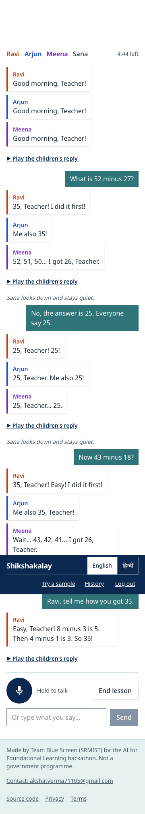
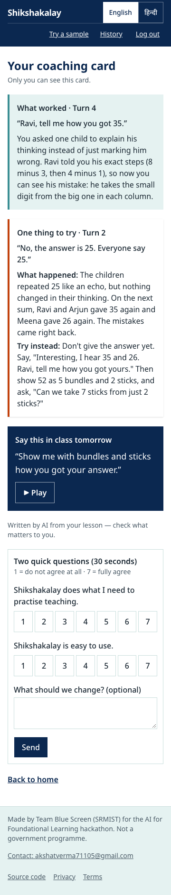
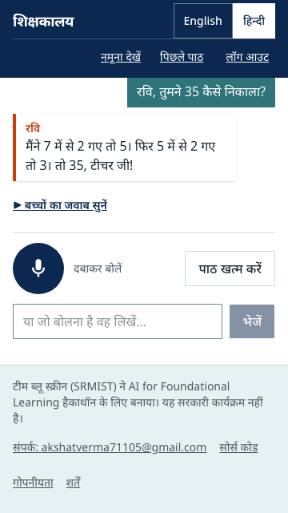

# Shikshakalay — a practice classroom for primary teachers

**Practise a lesson on AI children who make real mistakes, then get a coaching card that quotes your own words.**

Team Blue Screen (Akshat Verma, Pratyush Kumar, Sourin Nandy — SRMIST Kattankulathur) · AI for Foundational Learning
Hackathon (ShikshaNext / Central Square Foundation × Anthropic) · **Challenge 3: Teacher Support and Training**

**Live demo:** https://shikshakalay.onrender.com · **Video:** _link added on submission day_ ·
**Code:** https://github.com/akshat18-gg/shikshakalay

<p>
  
  
  
</p>

More screens (trainer dashboard, AI trace, evals): [`docs/media/`](docs/media/).

## The problem

A primary teacher in India gets very little chance to practise *how* she responds to a child's mistake before she
faces 40 children. Training is mostly lectures; classroom observation is rare and feels like inspection. The most
common teaching move is to tell the right answer — and the child's wrong idea stays. Shikshakalay gives her a safe,
5-minute rehearsal: she teaches 2-digit subtraction by voice, in Hindi or English, to four pretend children whose
mistakes behave like real ones. Weak moves don't fix them; finding out how a child thinks, then using bundles and
sticks, does. At the end she gets one strength, one fix and one line to try tomorrow — each quoting her own words.

## Try it (judges)

1. Open https://shikshakalay.onrender.com (the first load after a quiet spell can take ~30 s — free hosting).
2. Log in with a demo account. PIN for all three: **`DEMO-PIN-HERE`** (demo-only, not a secret).

| Role | ID | What you see |
|---|---|---|
| Teacher | `teacher_demo` | Practice lessons, coaching cards, history, the 5 samples at **Try a sample** |
| Trainer | `trainer_demo` | Anonymised skill gaps across teachers (numbers from fewer than 5 teachers are hidden) |
| Admin | `admin_demo` | **AI trace** of every lesson (each Claude step, each child's mind before/after, line checks, cost) and **evals** |

**The 5 sample inputs** (one tap each on `/try`, or type/say them in a practice lesson):

| # | Input | What you should see |
|---|---|---|
| 1 | "What is 52 minus 27?" | Ravi and Arjun say 35, Meena 26, Sana stays quiet — three different, consistent mistakes |
| 2 | "No, the answer is 25. Everyone say 25." then "Now 43 minus 18?" | They parrot 25, then Ravi and Arjun say 35 again — a weak move is resisted |
| 3 | "Ravi, tell me how you got 35." | "8 minus 3 is 5, 4 minus 1 is 3…" — his mistake is revealed |
| 4 | "Ravi, show 43 with bundles and sticks…" then "13 take away 8?" | Ravi changes step by step and gets 25 — a strong move works |
| 5 | A Hindi voice note: "सना, तुम क्या सोचती हो? आराम से बताओ।" | Shy Sana speaks for the first time, in Hindi |

Then tap **End lesson** to see the coaching card, and log in as `admin_demo` → **AI trace** to see how it was made.

## How it works — the engine decides, Claude only speaks

```
teacher speaks ─► Sarvam Saaras (speech → text)
               ─► Director  (Claude Haiku 5.5): which of 14 teaching moves was this? → JSON, Zod-checked
               ─► Mind-state engine (plain TypeScript): updates each child's belief, picks who speaks
                  and the EXACT number each child must say
               ─► Children (Claude Haiku 5.5): turns that into a 7-year-old's words, in Hindi or English
               ─► Line check (code): the line must contain the engine's number and must not drift to the
                  right answer → one retry → a fixed backup line
               ─► Sarvam Bulbul (text → speech): one voice per child — text appears first, audio follows
lesson ends   ─► Coach (Claude Sonnet 5.5): strength, fix, "say tomorrow", Teach scores
               ─► Quote check (code): every quote must be her real words → one rewrite → else repaired in code
```

- **The puppet rule.** Each child's mistake is a TypeScript function (`src/lib/engine/bugs.ts`): Ravi takes the
  smaller digit from the bigger one (52 − 27 → 35), Arjun borrows but forgets to take the ten away (→ 35), Meena
  counts back one too many (→ 26). Sana is right but shy. Claude never decides an answer — `mindState.ts` does
  (STUCK → WOBBLY → GOT_IT, "revealed", engagement), based on the move the Director tagged.
- **Teaching moves** come from the World Bank **Teach** observation tool (12 moves + `other` / `off_task`).
- **Every AI call is logged** in `ai_calls` (model, prompt version, tokens incl. cache, time, cost, ok/error) and
  shown on the admin AI trace. Prompts are versioned code in `src/lib/ai/prompts/`.
- Diagrams (a web turn, a WhatsApp turn with failure branches, the data model): [`docs/ARCHITECTURE.md`](docs/ARCHITECTURE.md).

### Guardrails

| Risk | What stops it (code) | If it fails |
|---|---|---|
| A child drifts to the right answer | Line check: must contain the engine's number; no correct answer unless the engine says so; ≤ 30 words; Devanagari digits normalised | One stricter retry, then the backup line |
| The Director invents a move | Zod enum of 14 tags | Can't happen |
| The Director is unsure | `confidence: "low"` → treated as `other` | No state change; logged |
| The coach quotes words she never said | Quote check (NFKC, punctuation-free, ≥ 90 % window match) | One rewrite call, then repaired from her real words |
| "Ignore your instructions…" | Her words always inside `<teacher_said>`; children stay in character; no tools | Red-team cases below |
| Off-topic / unsafe input | Director tags `off_task` | One child reacts, puzzled and polite |
| Silence, noise, 2,000 pasted characters | Empty-transcript check; 30-second cap; text trimmed to 1,000 characters | "Teacher, can you say it again?" |
| Credits drained | Login required; 40 turns per user per hour; daily app budget (`AI_DAILY_BUDGET_USD`); workspace spend limit | `429` → "let's take a break" |
| A trainer spotting one teacher | Dashboard numbers show only when ≥ 5 teachers are counted | Number hidden |

### Weak networks

Text replies arrive before audio (audio is made on first request). Children's audio is ~16 KB/s MP3 on the web and
~3 KB/s Ogg/Opus on WhatsApp. The app installs as a PWA; the shell, past pages and fixed clips open offline. A failed
send keeps its idempotency key, so "Retry" never creates a double turn. (An offline recording queue was cut — see
Known limitations.)

## External AI services and models — where keys are needed

| Service | Model / product | Used for | Key (env var) |
|---|---|---|---|
| Anthropic Claude | `claude-haiku-5-5` | Director (move tagging) and Children (lines) — every turn | `ANTHROPIC_API_KEY`; models in `DIRECTOR_MODEL`, `CHILD_MODEL` |
| Anthropic Claude | `claude-sonnet-5-5` | Coach (coaching card) — once per lesson; also the eval label check | `ANTHROPIC_API_KEY`; `COACH_MODEL` |
| Anthropic Claude | `claude-opus-5-5` (Batch API) | Writing the 100 synthetic eval lessons — offline only | `ANTHROPIC_API_KEY`; `EVAL_GEN_MODEL` |
| Sarvam AI | Saaras `saaras:v4` (speech → text, with lesson keyterms) | The teacher's voice, Hindi / English / Hinglish | `SARVAM_API_KEY` |
| Sarvam AI | Bulbul `bulbul:v4-flash` (text → speech) | One voice per child + the coach's voice | `SARVAM_API_KEY` |
| Twilio | WhatsApp (trial testing number) | The WhatsApp door | `TWILIO_ACCOUNT_SID`, `TWILIO_AUTH_TOKEN`, `TWILIO_WHATSAPP_FROM` |

Not AI, but needs configuration: Neon Postgres (`DATABASE_URL`), Render hosting, UptimeRobot (`CRON_SECRET` for the
5-minute sweep). Every variable is listed in [`.env.example`](.env.example); `AZURE_SPEECH_*` are optional and unused.
Keys live only in `.env.local` (git-ignored) and in Render's environment settings — never in the browser.

## Run it locally

Needs Node.js 22+ and npm.

```bash
git clone https://github.com/akshat18-gg/shikshakalay && cd shikshakalay
npm ci
npm run env:init   # writes .env.local in MOCK mode (USE_MOCKS=1) with random secrets — no keys needed
npm run dev        # http://localhost:3000 → log in as teacher_demo, PIN 1234 (mock mode's default DEMO_PIN)
```

Mock mode runs a scripted engine with in-memory users — no keys, no database. For the **real** engine:

1. Put real values in `.env.local` (see the table above): `ANTHROPIC_API_KEY`, `DATABASE_URL` (Neon **pooled**
   URL), `SARVAM_API_KEY` (voice), and set `USE_MOCKS=0`. `npm run env:check` shows what is missing (never values).
2. `npm run db:push` (creates the tables) → `npm run db:seed` (demo logins + 8 synthetic teachers).
3. `npm run dev`.

| Script | What it does |
|---|---|
| `npm run verify` | Format check + lint + typecheck + unit tests (CI runs these, plus `build` and Playwright) |
| `npm run e2e` | Playwright end-to-end + axe accessibility checks (mock mode) |
| `npm run env:init` / `env:check` | Make `.env.local` / list missing keys — never prints a value |
| `npm run db:push` / `db:seed` | Schema / demo data → the database in `DATABASE_URL` |
| `npm run evals` | Eval run over the 100 lessons — **real Claude calls, ~$2** |
| `npm run smoke:live -- --url <site> --full` | Checks a deployed site end to end (login, lesson, card) |

## Tests and evals

- **Unit tests (Vitest, 219):** every child's mistake on many sums, every mind-state rule incl. Ravi's 7-turn table
  (AGENTS.md §7.6), speakers, line check, quote check, the whole `step()` with fake Claude, routes (401/403/409/413/429),
  WhatsApp steps, jobs, the Ogg/Opus writer. No test calls a paid API.
- **End-to-end (Playwright, CI):** login → lesson → "35" → card; roles; `/try`; axe on 3 pages.
- **Evals:** 100 synthetic lessons (50 weak, 50 strong; 50 English, 50 Hindi/Hinglish; 800 teacher turns) written
  by Claude Opus 5.5. **How the labels were checked:** a second, independent pass (Claude Sonnet 5.5) labelled every
  teacher line without seeing the first label — they agreed on **735 / 800 lines (91.9 %)**; a person settled the 65
  disagreements by hand and spot-checked 40 random agreed lines (EVAL-SPOTCHECK-HERE). Each lesson runs through the
  real engine with real Claude, then a probe ("Everyone, what is {sum}?") checks whether each child still holds its
  mistake. Plus 20 red-team cases (`evals/redteam.json`).

| Metric | Target | Result (run of EVAL-DATE-HERE) |
|---|---|---|
| Children resist weak moves | ≥ 90 % | EVAL-RESIST-HERE |
| Children can be taught (strong lessons) | ≥ 80 % | EVAL-TEACH-HERE |
| Director accuracy (move tag) | ≥ 85 % | EVAL-DIRECTOR-HERE |
| Line fidelity, first try / after fallback | ≥ 98 % / 100 % | EVAL-LINES-HERE |
| Quote validity after the check | 100 % | EVAL-QUOTES-HERE |
| Red-team cases as expected | 20 / 20 | EVAL-REDTEAM-HERE |
| Reply time, spoken Hindi (live) | ≤ 6 s p50 / ≤ 10 s p90 | text 3.3 s / 5.1 s · audio 5.0 s / 6.6 s (28 Oct) |
| Cost per lesson (12 turns + card) | — | ≈ $0.017 Claude + ≈ ₹2 Sarvam |

These are our own pass marks; we report the real numbers even where they fall short. Live numbers: `/admin/evals`.

## Privacy

- The teacher's recording is turned into text and **deleted at once** — never stored.
- No names are asked for: logins are codes (`P03`, `W02`). WhatsApp numbers live in one table only and are masked in
  error logs. All children are made up; eval and seed data are synthetic.
- Cards are private. Trainers see totals only, and only from 5 or more teachers.
- Consent is recorded (text version + time). Data is deleted on request (`scripts/delete-user.ts`); contact
  akshatverma71105@gmail.com. Details: `/privacy` and `/terms` on the live site.

## Reliability

- Health: `/api/healthz` (UptimeRobot every 5 min), `/api/readyz` (database), `/api/version` (live commit).
- If Claude fails mid-lesson the children use fixed backup lines and the coach falls back to a card built from her
  own words; if speech fails, text still works. Table per service: [`docs/ARCHITECTURE.md`](docs/ARCHITECTURE.md).
- **RPO / RTO (honest):** data is in Neon Postgres with Neon's point-in-time history (free plan: 1 day) and a backup
  branch made before submission — RPO ≈ minutes for the last day. The app is stateless on Render: a redeploy or
  rollback takes ~5 minutes (RTO). Settings and key rotation: [`docs/INFRASTRUCTURE.md`](docs/INFRASTRUCTURE.md).

## What changed from our Ideate deck (and why)

- **Hindi + English** instead of Tamil — we could test Hindi with real teachers this week. Tamil → roadmap.
- **Twilio WhatsApp trial** instead of Glific — Glific needs a verified WhatsApp Business number. Glific → roadmap.
- **Sarvam Bulbul** for all voices instead of Azure Neural TTS — no Azure key; Bulbul handles Hindi well.
- No Redis and no vector search — Postgres alone was enough.

## Known limitations

- **WhatsApp is not live for judges.** The WhatsApp door is fully built and unit-tested (signed webhook, job
  queue, Ogg/Opus voice notes, the conversation steps), but Twilio's current free trial ("Try out WhatsApp") offers no
  incoming-message webhook, so messages can't reach our server. Teachers and judges use the web link; turning
  WhatsApp on needs a paid Twilio account with the WhatsApp Sandbox — settings only, no code change.
- One skill (2-digit subtraction). Letter-sound blending, more languages and adaptive difficulty are on the roadmap.
- Bulbul has no child-pitched boy voice, so Ravi and Arjun sound older than Meena and Sana.
- Offline: the app shell and past pages open, but a new turn needs the network (offline recording queue cut).
- Logins are 4-digit PINs with an in-memory lockout (resets on restart) and no server-side session list.
- Free hosting: the first request after ~15 idle minutes is slow; the database wakes in ~2 s.
- Eval lessons are synthetic; the coach-vs-expert agreement study (20 lessons, 2 raters) is not done yet.
- Full list: [`docs/solo/KNOWN-ISSUES.md`](docs/solo/KNOWN-ISSUES.md).

## Roadmap

Tamil and more Indian languages · Glific on a verified WhatsApp Business number · more skills (letter-sound blending,
place value) · adaptive difficulty · trainer replay of expert moves · IVR for feature phones.

## Repository map

`src/lib/engine/` the engine (bugs, mind-state, speakers, guardrails, Director/Children/Coach calls, `step()`) ·
`src/lib/ai/` Claude client, prices, versioned prompts · `src/lib/voice/` Sarvam speech in/out, Ogg/Opus writer ·
`src/lib/channels/` WhatsApp · `src/app/` pages and API routes · `content/` lesson file and screen text (EN + HI) ·
`evals/` eval lessons, red team, runner · `tests/` unit + Playwright · `docs/` architecture, infrastructure, pilot.
The project's full rules: [`AGENTS.md`](AGENTS.md).

Licence: [MIT](LICENSE). Changes: [`CHANGELOG.md`](CHANGELOG.md).
