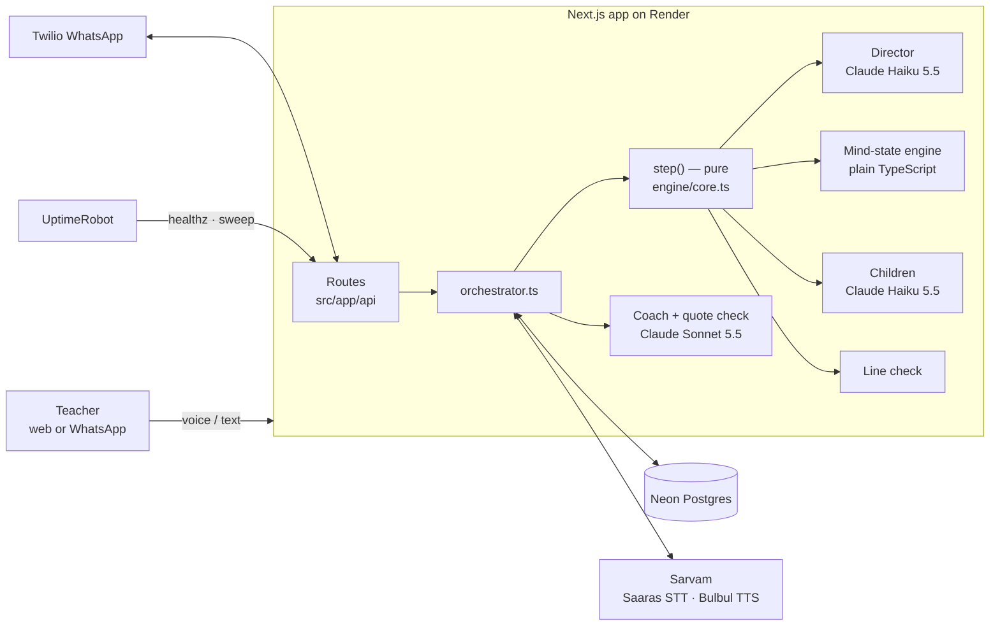
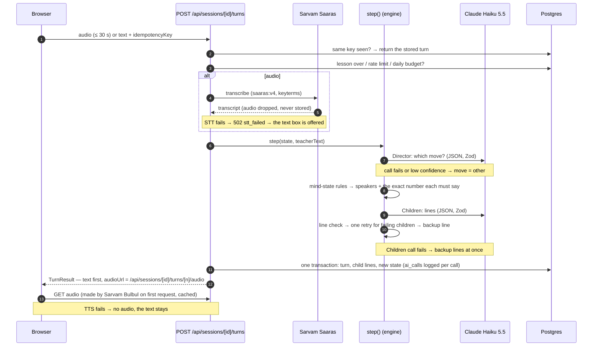
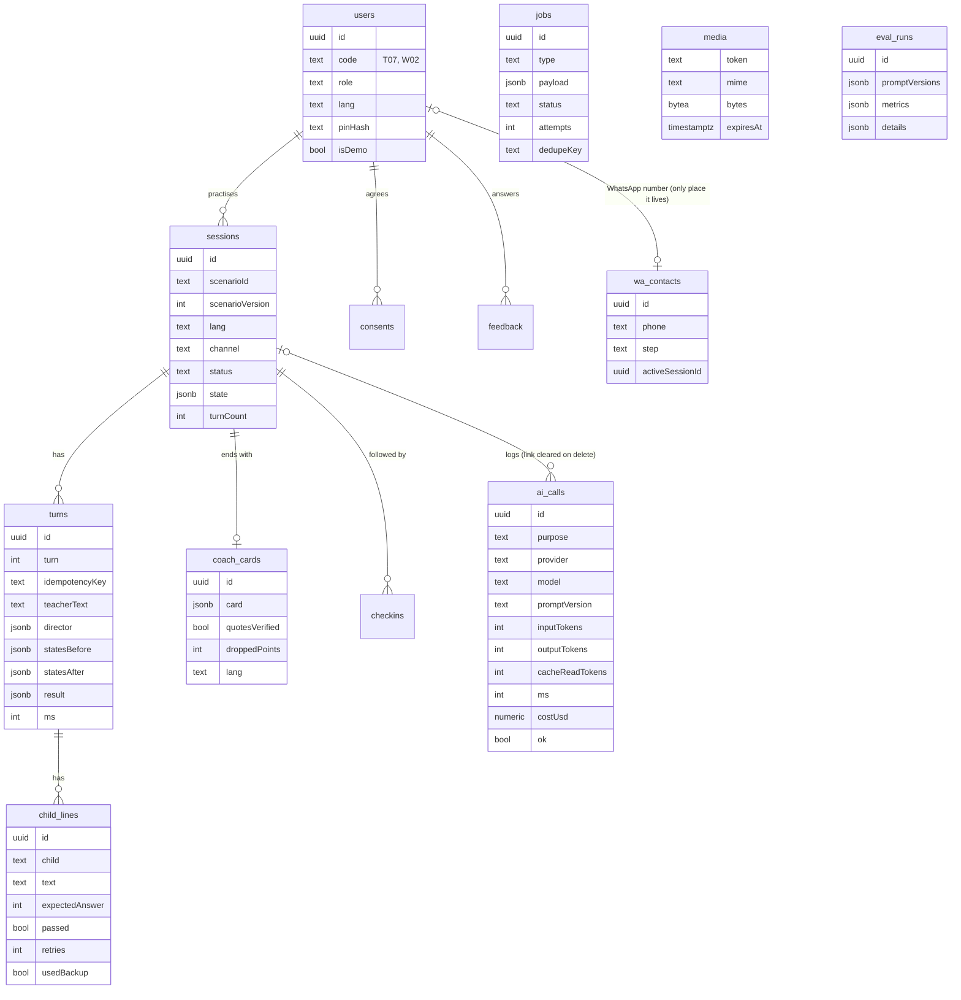

# Architecture

One Next.js 16 app (App Router, Node.js runtime) on Render, one Neon Postgres database, three outside services
(Anthropic, Sarvam, Twilio). No queue server, no cache server: background work is a Postgres `jobs` table plus
Next.js `after()` and a 5-minute sweep.



**Where a child's answer is decided:** `engine/mindState.ts` (beliefs) and `engine/speakers.ts` (who speaks, what
number). Claude only writes words (`engine/children.ts`), and `engine/guardrails.ts` rejects any line that doesn't
carry the engine's number.

## A web turn



## A WhatsApp turn (with failure branches)

```mermaid
sequenceDiagram
  autonumber
  participant WA as Twilio (WhatsApp)
  participant H as POST /api/whatsapp/webhook
  participant DB as Postgres (jobs)
  participant J as job (after())
  participant E as engine (runTurn)
  participant SW as /api/cron/sweep (every 5 min)
  WA->>H: voice note / text (signed)
  H->>H: X-Twilio-Signature valid? (no → 403)
  H->>DB: insert job (dedupeKey = MessageSid; duplicate → ignored)
  H-->>WA: empty TwiML reply at once
  H->>J: after(): run the job
  J->>DB: contact step (consent → language → menu → lesson)
  J->>WA: download the voice note (Twilio auth, ≤ 2 MB)
  J->>E: runTurn(sessionId, audio | text, idempotencyKey = MessageSid)
  Note over J,E: another message mid-turn → busy → "one moment"
  E-->>J: lines + Ogg/Opus voice note (Sarvam WAV → opusscript)
  J->>WA: voice note, then ~3 s later the "who said what" text
  Note over J,WA: TTS fails → text only · send fails → job retried (3 tries, 1 min apart)
  J->>DB: job done (payload cleared — number and words not kept)
  SW->>DB: due or stuck jobs (FOR UPDATE SKIP LOCKED) → run again; delete expired audio
```

`STOP` stops all messages. The next-evening check-in ("did you try the line?") is a job with a future `runAt`,
skipped if WhatsApp's 24-hour window has closed.

## Data model



Uniques: `users.code`, `(session_id, turn)`, `(session_id, idempotency_key)`, `coach_cards.session_id`,
`jobs.dedupe_key`, `wa_contacts.phone`. Every foreign key and filter column is indexed (13 `*_idx`).

## If a service is slow or down

| Service | Slow | Down |
|---|---|---|
| **Anthropic (Claude)** | Per-call timeouts (Director/Children 15 s, Coach 45 s); the turn waits | Director → `other` (no state change); Children → fixed backup lines with the engine's number; Coach → a plain card built from her own words. The lesson never stops |
| **Sarvam Saaras (speech → text)** | Timeout, then as "down" | `502 stt_failed`: "please type" — the text box always works |
| **Sarvam Bulbul (text → speech)** | Text is already on screen; audio comes later | No audio; text only (web and WhatsApp) |
| **Twilio** | Messages go out ~3 s apart anyway | Job fails → retried 3 times (1 min apart) by `after()` and the sweep; the web app is unaffected |
| **Neon Postgres** | First query after ~5 idle minutes takes ~2 s (wake-up) | `/api/readyz` → 503; routes answer `500` with a reference id; mock mode is unaffected |
| **Render** | Free instance sleeps after ~15 idle minutes (UptimeRobot pings `/api/healthz` every 5) | Site down — redeploy or roll back from the Render dashboard (`docs/INFRASTRUCTURE.md`) |

## Why this shape

- **Monolith on purpose:** one deploy, one log stream, no network hops between "services" — right for one week
  and one server. Routes are thin (parse → auth → one `src/lib` call → JSON); no SQL in route files.
- **`step()` is pure:** it takes the state, her words and the two Claude callers, and returns the new state. Unit
  tests and the eval runner use it with no database or HTTP.
- **Text first:** a turn returns as soon as the children's lines exist; audio is fetched separately, so a slow
  voice provider never delays what she reads.
